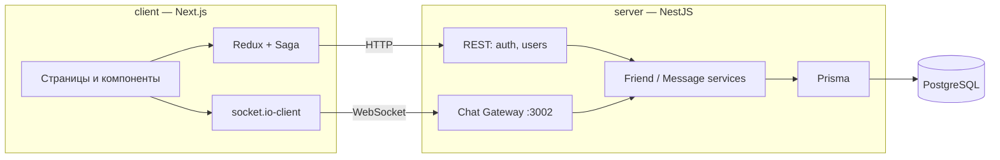

# Messenger

Мессенджер в реальном времени: регистрация, поиск людей, добавление в друзья, личные чаты, статус «в сети» и счётчик непрочитанных сообщений.


## Возможности

- Регистрация и вход, JWT access + refresh токены (refresh хранится в httpOnly cookie)
- Поиск пользователей и добавление в друзья
- Личные сообщения в реальном времени через WebSocket
- Статус «в сети» и время последнего визита
- Счётчик непрочитанных сообщений
- Редактирование и удаление сообщений, удаление чата
- Смена имени, пароля и аватарки

## Архитектура



## Карта проекта

```
messenger/
├── client/                         # Фронтенд на Next.js (App Router)
│   └── src/
│       ├── app/
│       │   ├── page.tsx            # Стартовая страница
│       │   ├── login/              # Вход и регистрация
│       │   └── chat/               # Основной экран мессенджера
│       ├── components/
│       │   ├── NavigationChats/    # Список чатов слева
│       │   ├── ChatSearch/         # Поиск людей
│       │   ├── Group/              # Карточка чата / собеседника
│       │   ├── Login/, Register/   # Формы авторизации
│       │   └── PostTimestamp/      # Форматирование времени сообщения
│       ├── store/                  # Redux: actions, reducers, sagas (запросы к API)
│       ├── socket/socket.ts        # Подключение к WebSocket-серверу
│       └── config.ts               # Адреса API и сокета
│
└── server/                         # Бэкенд на NestJS
    ├── prisma/schema.prisma        # Модели: User, Token, Message, Friend
    ├── docker-compose.yaml         # PostgreSQL + Redis для локальной разработки
    └── src/
        ├── auth/                   # Регистрация, логин, refresh, Passport-стратегии
        ├── token/                  # Выдача и проверка JWT
        ├── users/                  # Профиль, поиск, друзья, загрузка аватарки
        └── chat/
            ├── chat-gateway.ts     # WebSocket-события: сообщения, статусы, чаты
            └── services/           # Логика друзей и сообщений
```

### WebSocket-события

| Событие | Что делает |
|---|---|
| `newMessage` | отправить сообщение |
| `getChats` | получить список чатов |
| `getMessagesUser` | история переписки с пользователем |
| `deleteMessage` | удалить сообщение |
| `addFriend` | добавить в друзья |
| `userStatusUpdate` | онлайн / офлайн |
| `unreadMessagesCount` | количество непрочитанных |

## Запуск

```bash
# 1. База данных
cd server
cp .env.example .env
docker compose up -d

# 2. Сервер (REST на :3001, WebSocket на :3002)
npm install
npx prisma migrate dev
npm run start:dev

# 3. Клиент (http://localhost:3000)
cd ../client
npm install
npm run dev
```
